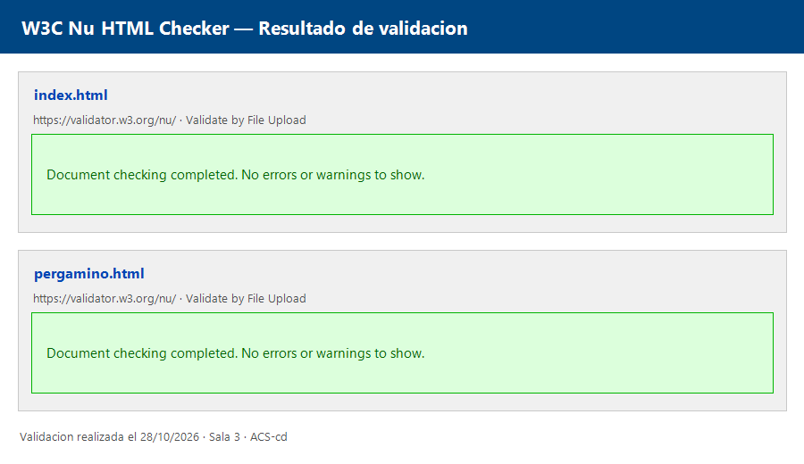

# Sala 3 · Nombre de la sala (HTML) · Morgue municipal · Soporte técnico

**Autor/a:** Angela Colorado Sousa - ACS-cd
**Compañero/a (JavaFX):** David Cabrera González - IZialexI

## La historia
Desde el 13 de octubre el sistema de soporte técnico de la morgue municipal funciona de forma extraña: contraseñas que se escriben solas, botones que huyen del ratón… y el departamento TI no encuentra el fallo.

## La pista
Un comentario oculto en el código de index.html indica que el usuario válido está en pergamino.html.

## Captura

## Captura de validación W3C

## Créditos
Imágenes y sonidos con autor, web y licencia.
- Imágenes: [Pixabay](https://pixabay.com) (licencia de contenido de Pixabay).
- `audio/morgue.mp3`: sonido ambiente sintetizado por ordenador expresamente para esta sala (zumbido, viento, latido y chirridos). Sin derechos de terceros.
- `js/pesadilla.js`: comportamientos extra (la pestaña te llama, textos que cambian cuando no miras, botón que huye, cuenta de visitas, hora real, destello). La sala funciona igual sin él. Para probar: `index.html?hora=3` (hora maldita), `?susto=1` (destello a los 3 s), `?susto=ver` (la cara fija) y `?cursor=1` (segundo cursor a los 3 s).
- `camara13.html`: página secreta (se llega pulsando el botón «Entrar» o desde el punto final del pie de página).
- `css/pesadilla.css`: efectos extra de la sala. `css/terror.css` se mantiene tal cual la dio la profesora.

---

## Diario de investigación
Una entrada por reto (8 en total). Rellénala mientras trabajas y súbela en el commit de ese paso.

### Reto 1 · La voz del narrador
- **Pregunta:** ¿strong o b para la palabra que asusta? ¿em o i?
- **Fuente:** https://developer.mozilla.org/es/docs/Web/HTML/Element/strong
- **Lo que dice (con mis palabras):** `<b>` pone el texto en negrita, `<strong>` indica que es importante, los lectores para personas ciegas indican que es un texto importante, con `<b>` no ven nada, los buscadores como Google le dan más importancia a lo marcado por esta etiqueta, a mayores, terror.css hace referencia a `<strong>`, la referencia se rompería.
- **Prueba en pruebas.html:** No hay diferencias visuales entre `<b>` y `<strong>` y entre `<i>` y `<em>`, sin embargo, con terror.css, strong sale en rojo.
- **Decisión en mi sala:** Uso `<strong>` en "soporte técnico" porque es importante, y `<em>` en "se escribe sola" para darle énfasis al leerlo.
- **Pista de nivel usada:** ninguna

### Reto 2 · Tachado, letra pequeña, sup, sub, abbr y comentarios
- **Pregunta:** ¿qué etiqueta uso para algo borrado, una nota en letra pequeña, un superíndice, un subíndice, una palabra que se explica al pasar el ratón y un texto oculto?
- **Fuente:** https://developer.mozilla.org/es/docs/Web/HTML/Element/abbr y el índice de elementos de MDN
- **Lo que dice (con mis palabras):** `<del>` marca texto eliminado, `<small>` sirve para aclaraciones o notas legales, `` y `` suben o bajan el texto, y `<abbr>` con el atributo `title` muestra la explicación al pasar el ratón. Un comentario `<!-- -->` no se ve en la página pero sí en el código fuente.
- **Prueba en pruebas.html:** Probé `<abbr title="...">` y salía el texto al pasar el ratón. Con Ctrl+U vi el comentario en el código fuente.
- **Decisión en mi sala:** `<del>` en "correctamente", `<abbr>` en "departamento TI", `` en 4 ºC, `` en CH₂O, `<mark>` en "No entréis solos", `<small>` en el mensaje automático, y un comentario con la pista hacia pergamino.html.
- **Pista de nivel usada:** ninguna

### Reto 3 · El menú de enlaces y el footer
- **Pregunta:** ¿Cómo enlazo a una sección de la misma página, a otra página y a una web externa de forma segura?
- **Fuente:** MDN · a (https://developer.mozilla.org/es/docs/Web/HTML/Element/a) y MDN · nav (https://developer.mozilla.org/es/docs/Web/HTML/Element/nav).
- **Prueba:** Abrí la página y probé cada enlace del menú: los de `#historia`, `#lista` y `#pergamino` saltan a la sección que tiene ese `id`, y «Abrir a pantalla completa» abre `pergamino.html`. El enlace a Pixabay se abre en otra pestaña.
- **Decisión:** Usé `<nav>` con una lista `<ul>` para el menú, `href="#id"` para las secciones, `href="pergamino.html"` para la otra página y `<footer>` para los créditos. El enlace externo lleva `target="_blank" rel="noopener"` para que la página nueva no pueda controlar la nuestra.
- **Nivel de pista usado:** 2

### Reto 4 · Las normas para sobrevivir
- **Pregunta:** ¿Cuándo uso una lista ordenada (`ol`) y cuándo una no ordenada (`ul`)? ¿Dónde va la lista de dentro para que el validador no dé error?
- **Fuente:** https://developer.mozilla.org/es/docs/Web/HTML/Element/ol y https://developer.mozilla.org/es/docs/Web/HTML/Element/ul
- **Lo que dice (con mis palabras):** `ol` es para cuando el orden importa (pasos) y `ul` para cuando da igual. Dentro de un `ol` o un `ul` solo pueden ir `li`, así que una lista anidada tiene que ir dentro de un `li`.
- **Prueba en pruebas.html:** Puse el `ul` directamente dentro del `ol`, fuera de un `li`. El validador dijo: «Error: Element `ul` not allowed as child of element `ol` in this context.» (línea 17). Es decir, un `ul` no puede ser hijo directo de un `ol`. Al meter el `ul` dentro del segundo `li`, antes de `</li>`, el error desapareció.
- **Decisión en mi sala:** uso `ol` en los pasos de «Cómo recuperar tu acceso» porque el orden importa, y `ul` en los consejos del paso 2 porque el orden da igual. Marco «apágala» con `strong` porque es lo más importante.
- **Pista de nivel usada:** ninguna

### Reto 6 (parte 1) · El documento secreto
- **Pregunta:** ¿Qué partes del esqueleto del paso 1 se repiten en cualquier página y cuáles cambian? ¿Cómo enlazo la misma hoja de estilos desde una segunda página? ¿Qué es un atributo global como `class` y para qué lo usa la hoja de estilos?
- **Fuente:** https://developer.mozilla.org/es/docs/Web/HTML/Global_attributes y https://developer.mozilla.org/es/docs/Web/HTML/Global_attributes/class
- **Lo que dice (con mis palabras):** Un atributo global es uno que se puede poner en cualquier etiqueta HTML, como `id`, `title`, `lang` o `class`. `class` le da a un elemento uno o varios nombres que la hoja de estilos usa para aplicarle estilos solo a él y a los que tengan esa misma clase. El esqueleto (`<!DOCTYPE>`, `<html lang>`, `<head>` con `meta` y `link`) es igual en todas las páginas; lo que cambia es el `<title>` y el contenido del `<body>`.
- **Prueba en pruebas.html:** Puse `<body>` sin clase y la página salió con el estilo general de la sala (negro y rojo). Al añadir `class="pergamino"` cambió a fondo color papel y letras marrones, así que la hoja de estilos tiene reglas distintas para esa clase.
- **Decisión en mi sala:** Creo `pergamino.html` junto a `index.html` con el mismo `<head>`, cambiando solo el título a «Registro de usuarios · Sala 3». El `<link>` usa la misma ruta `css/terror.css` porque las dos páginas están en la misma carpeta. Pongo `class="pergamino"` en el `<body>`. Los usuarios dados de baja van con `<del>` porque ya no valen, `caronte` con `<strong>` porque es el importante y «fallecimiento» con `<em>` porque lleva énfasis.
- **Pista de nivel usada:** ninguna

### Reto 6 · Incrustar el pergamino
- **Pregunta:** ¿Qué etiqueta muestra una página dentro de otra? ¿Por qué es obligatorio darle un nombre accesible y qué oye una persona con lector de pantalla si no lo tiene? ¿Qué atributos controlan su tamaño?
- **Fuente:** https://developer.mozilla.org/es/docs/Web/HTML/Element/iframe
- **Lo que dice (con mis palabras):** `iframe` incrusta otra página HTML dentro de la actual, y con `src` indicas cuál. El atributo `title` le da un nombre accesible: el lector de pantalla lo anuncia para que la persona sepa qué contiene el marco antes de entrar. Sin él solo oiría algo como «marco» sin saber qué es. El tamaño se controla con `width` y `height`, que en HTML van en píxeles y sin unidad.
- **Prueba en pruebas.html:** Incrusté `pergamino.html` con un `iframe` y se vio la página dentro de la otra. Cambié `width` y `height` y el marco cambió de tamaño. Quité el `title`, pasé el archivo por el validador y comprobé qué decía.
- **Decisión en mi sala:** Añado una tercera sección con `id="pergamino"` debajo de las normas, con su `h2`, el párrafo y un `iframe` con `src="pergamino.html"`, `title="Registro de usuarios"`, `width="600"` y `height="400"`. Pongo el `title` porque sin él el marco no es accesible.
- **Pista de nivel usada:** ninguna

### Reto 7 · La pista escondida
- **Pregunta:** ¿Cómo escondo la pista (el usuario válido `caronte`) usando solo HTML? ¿Qué forma encaja mejor con la temática y con el programa de 2.º?
- **Fuentes:** https://developer.mozilla.org/es/docs/Web/HTML/Element/details · https://developer.mozilla.org/es/docs/Web/HTML/Element/abbr · https://developer.mozilla.org/es/docs/Web/HTML/Element/mark
- **Comparativa de opciones:**
  - **`abbr` con `title`:** la pista aparece como tooltip al pasar el ratón sobre la palabra. No se ve a simple vista, muy oculto; pero si el visitante no pasa el ratón exactamente ahí, jamás lo encuentra. Además, en móviles sin ratón no funciona.
  - **`details` + `summary`:** crea un bloque desplegable. No se ve a simple vista, hay que hacer clic en el resumen para revelar el contenido. Es más dramático y teatral, encaja bien con la temática de terror. Cualquier visitante curioso lo encuentra sin necesidad de adivinar dónde pasar el ratón.
- **Lo que dice MDN (con mis palabras):** `
` es un elemento que muestra u oculta contenido; `
` es el título que siempre se ve y al que se hace clic para expandir. Es nativo del navegador, sin JavaScript. `<abbr>` con `title` muestra un tooltip solo al pasar el ratón, sin garantía en móviles.
- **Prueba en pruebas.html:** Probé ambas opciones. Con `abbr`, al pasar el ratón sobre "caronte" salía la pista en un pequeño tooltip. Con `details`, al hacer clic en "Nota del archivero" se desplegaba el texto con el nombre de usuario. La versión `details` fue más llamativa y fiable en todos los dispositivos.
- **Decisión en mi sala:** Usé `
` + `
` en `pergamino.html`. Añadí un bloque con el resumen «Nota del archivero» que al desplegarse revela que el usuario `caronte` fue el último en acceder. La pista ya era visible (es el único nombre sin `<del>`), y el `details` añade un nivel de teatralidad extra. Encaja con el curriculum de 2.º porque es una etiqueta semántica HTML5 estándar.
- **Pista de nivel usada:** ninguna

### Reto 8 · Valida y entrega
- **Pregunta:** ¿Qué errores da el validador del W3C? ¿Qué significa cada uno y cómo se corrige?
- **Fuente:** https://validator.w3.org/ y MDN
- **Proceso:** Subí `index.html` y `pergamino.html` al validador W3C (Validate by File Upload) en https://validator.w3.org/nu/
- **Errores encontrados:** Ninguno. Ambos archivos superaron la validación sin errores ni advertencias.
  - `index.html` → «Document checking completed. No errors or warnings to show.»
  - `pergamino.html` → «Document checking completed. No errors or warnings to show.»
- **Por qué no hay errores:** El HTML está bien estructurado desde el principio: `<!DOCTYPE html>` presente, `<html lang>` con idioma, `<meta charset>` en primera posición, todas las etiquetas cerradas correctamente, `<ul>` anidado dentro de `<li>` (no directamente en `<ol>`), `<iframe>` con `title` accesible, imágenes con `alt`, y `
` + `
` usados correctamente según la especificación HTML5.
- **Captura:** `docs/validacion.png`
- **Pista de nivel usada:** ninguna
